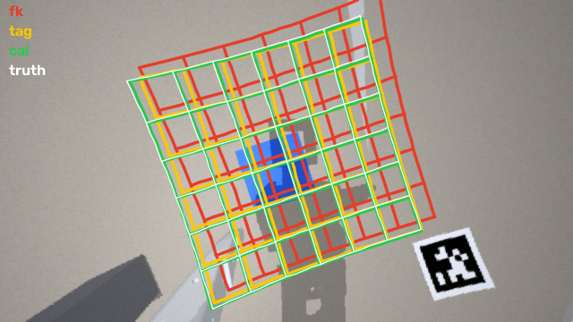

# Does a table AprilTag help the wrist camera?

**Verdict: print a tag, but use it to calibrate the arm once, not as a reference at run time.**

- **Localize-then-reach (look, back-project, IK) gains the most, through calibration.** With realistic errors on
  (joint zeros 2-6 deg off, 1.5 cm of sag, a mount off by ~5 mm and ~3 deg), eight tag views and a least-squares fit
  of the mount, the joint zeros and the sag bring this experiment's wrist-only policy from **9/20 placed to 18/20**,
  its score with no errors at all. No tag is on the table at run time.
- **Using the tag only at run time hurts that approach: 6/20.** The tag puts the box within ~1 cm in the world, but the
  arm still moves through its wrong model. Without the tag, the same wrong model both locates the box and reaches for
  it, so most of the error cancels: the box is 2.5 cm off in the world, yet the jaws land 1.1 cm from it. Correcting
  the camera alone breaks that cancellation, and the jaws land 2.1 cm off.
- **Closed-loop approaches that correct from the image every tick gain little.** Servoing over the box on the image
  already cancels the joint errors and the sag. What is left (1.0 cm at the grasp, median) is the reference pixel and
  the last descent. Teaching the reference once, with a box held in the jaws, halves it without any tag, and servoing
  all the way down would cancel the rest.
- **Grid-drawing drivers (PR #5):** an FK grid on the frame is 3.2 cm off the table under these errors. A tag-drawn
  grid is 0.6-1.2 cm off, but moves to its labels still land 2.2-2.4 cm off. After calibration, the grid is 0.2 cm off
  and so are the moves.
- **Team 6's code-as-policy program (PR #8) does not keep its 20/20 under realistic errors.** With local H2O
  perception it places **5/20** with no tag. With the tag at run time it places **2/20**; after a one-time tag
  calibration, **14/20**. Of the six misses left, two come from its straight-down grasp asking the wrist for more
  than its range once the zero error is added back, two from perception, and two are undiagnosed
  ([below](#team-6s-program-under-errors)).

Worth printing for the real arm: yes, a 5 cm 36h11 tag taped at a measured spot beside the base, used for an
eight-view sweep whenever the arm is re-zeroed or the camera is bumped. Two caveats. The sim's errors are tidy: fixed
offsets, linear sag, a rigid mount. Real backlash and hysteresis will leave more behind. And the wrist roll's zero
cannot be seen by a camera on the wrist (1.6 deg left after the fit), since it trades exactly against a turn of the
mount.

Everything ran in simulation (valet-sim); nothing touched the arm. The geometry experiments used no model at all.
Team 6's program used the local H2O-Lightning-4B for `localize`, at $0. The only API spend was about 15 Jev calls,
made while trying Jev as the policy's check (about $0.03); there was no Claude spend.

## 1. Setup

**Opt-in sim support** (defaults unchanged: all 20 expert episodes reproduce `main` bit for bit, scores, final state
and final wrist frame):

- `SceneSpec.tag: TagSpec | None = None`: a 5 cm AprilTag 36h11 (black square edge; one white cell around it, as on
  paper) lying on the table at (0.14, -0.23), beside the base on the arm's right. It sits clear of every box and target
  the benchmark draws. The start pose sees it in 19 of 20 scenes and a look straight down at the box or the square
  in about half (a bigger tag does not fit outside the task area). `tag_corners()` gives its corners in OpenCV's
  detection order; an overhead render detects it there to under 2 px.
- `SimSpec.errors: Errors`, all zero by default: `joint_offsets_deg` (readings and goals are the true angle plus the
  offset, as with a mis-zeroed servo), `compliance_deg_per_nm` (each arm joint bends past its reading by its load
  torque; 4.0 sags the grasp point 1.5 cm at the far edge of the task area) and `mount_shift_m`/`mount_tilt_deg`
  (the camera off its `Look` pose). With errors on, `state()`, `joints()` and `grasp_point()` report what the arm
  believes; `truth()` adds the true joints, grasp point and camera pose for measuring.

**Errors drawn per scene** (`apriltag_exp/errors.py`, seeded, so every method sees the same arm): each arm joint's
zero off by 2-6 deg either way; compliance 4.0; mount shifted N(0, 4 mm) and tilted N(0, 2 deg) per axis; under
`all`, the tag also taped down 2 mm / 1 deg away from where the policy believes it is.

**What the policy knows** (`camera.py`): nominal kinematics (Menagerie's model, as the URDF), the nominal mount
from `Look`, and the lens model (pinhole from `fovy`, closed-form barrel undistortion). With no errors it puts the
tag's corners within 0.8 px of where they are rendered.

**Pixels.** Colour detectors (`detect.py`): the box is the biggest cool-white patch (the table is warm beige), the
square the biggest saturated blue one, both with the jaws masked out. In the looks straight down they are within
1.8 px (box, median; 4 px max) and 0.8 mm (square) of the truth. Every table is also given for the true pixel, the
truth projected through the true camera, which isolates the geometry.

## 2. Localization: where the box and the square are, and where the arm then goes

`localize.py`, 20 benchmark scenes per error kind, 100 trials, no failures. The policy takes the same frames for
every method: the start view, a look straight down at the box from 20 cm (and a second, higher one 6 cm to the
side, for triangulation), and a look down at the square. Only the camera pose differs:

| method | camera pose |
|---|---|
| fk | forward kinematics of the readings, nominal mount: today |
| fk_tri | fk, with the box triangulated from the two box looks instead of assuming its height (the best tag-free option) |
| tag | the tag's PnP pose in any frame that shows it; otherwise the last tag view, carried by the FK change since |
| mount_cal | fk with the mount from a hand-eye fit to a sweep of tag views (no tag at run time) |
| cal | fk with mount, joint zeros and sag fitted to the sweep (no tag at run time); moves corrected the same way |
| cal_tag | cal, plus the tag at run time as in `tag` |

Two errors are reported. **World**: the estimate minus the truth. **Reach**: tell the arm, through the same model,
to put its grasp point at the estimate, and measure how far it truly lands from the object. That is what a grasp sees.
The reach probe uses the same arm with the box moved off the table, IK polished to 0.5 mm, and one nudge for the
servos stopping short.

**Box, detector pixels**, cm, median (90th percentile), world / reach:

| method | none | joint zeros | sag | mount | all |
|---|---|---|---|---|---|
| fk | 0.1 (0.3) / 0.1 (0.3) | 2.4 (3.3) / 0.4 (0.8) | 0.6 (0.8) / 0.3 (0.6) | 0.6 (1.4) / 0.6 (1.4) | 2.5 (3.3) / **1.1** (1.4) |
| fk_tri | 0.1 (0.2) / 0.1 (0.2) | 2.5 (3.6) / 0.5 (1.1) | 0.6 (0.9) / 0.4 (0.4) | 0.7 (1.2) / 0.7 (1.2) | 2.7 (3.9) / 0.6 (2.0) |
| tag | 0.3 (0.5) / 0.3 (0.5) | 0.7 (2.1) / 2.3 (3.3) | 0.6 (1.1) / 0.3 (0.9) | 0.4 (0.8) / 0.4 (0.8) | 1.1 (2.3) / **2.1** (3.2) |
| mount_cal | 0.1 (0.3) / 0.1 (0.3) | 1.6 (3.2) / 2.6 (3.3) | 0.9 (1.0) / 0.9 (1.1) | 0.2 (0.4) / 0.2 (0.4) | 1.7 (3.7) / 2.6 (3.3) |
| cal | 0.2 (0.3) / 0.2 (0.4) | 0.2 (0.6) / 0.2 (0.6) | 0.2 (0.5) / 0.2 (0.3) | 0.2 (0.4) / 0.2 (0.4) | 0.4 (1.0) / **0.3** (0.6) |
| cal_tag | 0.3 (0.5) / 0.3 (0.5) | 0.4 (0.7) / 0.4 (0.8) | 0.5 (1.0) / 0.5 (0.8) | 0.4 (0.7) / 0.4 (0.7) | 0.7 (1.1) / 0.5 (1.0) |

**Blue square, detector pixels**, same layout:

| method | none | joint zeros | sag | mount | all |
|---|---|---|---|---|---|
| fk | 0.1 (0.1) / 0.1 (0.1) | 2.8 (4.1) / 1.0 (1.5) | 1.1 (1.2) / 0.3 (0.4) | 0.8 (1.6) / 0.8 (1.6) | 3.0 (5.0) / **1.2** (1.8) |
| tag | 0.3 (0.5) / 0.3 (0.5) | 0.3 (2.1) / 2.3 (3.4) | 0.4 (0.9) / 0.6 (0.9) | 0.5 (0.8) / 0.5 (0.8) | 0.6 (3.3) / **2.1** (3.3) |
| mount_cal | 0.1 (0.1) / 0.1 (0.1) | 0.6 (1.4) / 2.0 (2.9) | 0.4 (0.4) / 0.6 (0.7) | 0.1 (0.1) / 0.1 (0.1) | 0.8 (2.0) / 2.0 (2.9) |
| cal | 0.1 (0.1) / 0.1 (0.1) | 0.1 (0.2) / 0.1 (0.2) | 0.1 (0.2) / 0.1 (0.1) | 0.1 (0.1) / 0.1 (0.1) | 0.2 (0.5) / **0.1** (0.2) |
| cal_tag | 0.3 (0.5) / 0.3 (0.5) | 0.3 (0.4) / 0.3 (0.5) | 0.3 (0.5) / 0.2 (0.5) | 0.3 (0.5) / 0.3 (0.5) | 0.4 (0.6) / 0.3 (0.4) |

The geometry alone (the true pixel instead of the detector's) gives the same picture within 0.1-0.3 cm; all four
tables are in `results/tables.md`. Paired over the 20 scenes with all errors on, `cal` reaches closer than `fk` in
18 (box) and 19 (square) of them, and `tag` reaches farther than `fk` in 16 of each. A reach error above 8 mm (the
fixed jaw's clearance from the box) happens in 13 of 20 scenes for `fk`, 2 for `cal` and 20 for `tag`.

What the table says:
- **The errors that matter are the ones that do not cancel.** Joint zeros put the box 2.4 cm off in the world but
  only 0.4 cm off in reach, because the look straight down is close to the grasp pose. The mount error does not
  cancel at all (0.6 / 0.6): it moves the camera and not the jaws. Sag partly cancels.
- **Triangulating instead of assuming the box height** removes the height error (0.0 cm world error with true pixels
  and no arm errors) but not the arm's; with the detector's pixels it is noisier, and it does not change the picture.
- **The tag at run time** fixes the world estimate and makes the reach worse whenever the joints are off. The tag's
  own pose is also not free. The 5 cm tag is 59 px across in the start view, and the camera pose from it is off by
  9.4 mm and 1.25 deg (one corner sits 1.6 px off, and depth goes as distance over tag size). Closer views are better,
  but the tag is in only about half of them.
- **A hand-eye fit of the mount alone** is exact when only the mount is off, and badly wrong when the joints are off
  too, because it absorbs their error into the mount (next section).

## 3. Calibration: a sweep of tag views

`calib.py`: ten poses that look at the tag from above and from the side, rolled both ways and spread over 12-32 cm
of height. About 2 s each; 8 of the 10 see the tag. A least-squares fit (scipy, soft-L1, nine starts) of the tag
corners' reprojection, with mild priors, over the mount (6), the joint zeros (5) and one compliance. Residual 0.47 px
RMS.

Mount error after the fit, mm / deg, median (90th pct), 20 scenes per row:

| errors on | nominal mount | hand-eye, mount only | full fit | joint zeros left, deg | sag fitted (true 4.0) |
|---|---|---|---|---|---|
| none | 0.0 / 0.00 | 0.3 / 0.07 (0.3 / 0.07) | 1.5 / 0.23 (1.5 / 0.23) | 0.21 (0.21) | -0.25 (true 0) |
| joint zeros | 0.0 / 0.00 | 35.3 / 10.95 (74.0 / 20.73) | 2.1 / 1.71 (2.6 / 2.46) | 0.36 (0.55) | 0.08 (true 0) |
| sag | 0.0 / 0.00 | 22.1 / 5.09 (22.1 / 5.09) | 1.3 / 0.44 (1.3 / 0.44) | 0.26 (0.26) | 3.65 |
| mount | 5.4 / 2.64 (8.8 / 4.54) | **0.3 / 0.11** (0.5 / 0.16) | 1.3 / 0.52 (1.7 / 1.51) | 0.33 (0.44) | -0.28 (true 0) |
| all | 5.4 / 2.64 (8.8 / 4.55) | 43.0 / 12.58 (74.1 / 22.17) | **2.0 / 1.62** (3.8 / 2.56) | 0.67 (1.25) | **4.03** |

("Joint zeros left" is the largest error left over pan, lift, elbow and flex. Per joint, the median error left is
0.30, 0.27, 0.34 and 0.41 deg. The wrist roll's is 1.6 deg: a camera on the wrist cannot tell a roll error from a
mount turned about the roll axis, so the prior keeps it near zero and the mount absorbs it.)

- **Hand-eye alone recovers a perturbed mount**, from 5.4 mm / 2.6 deg to 0.3 mm / 0.1 deg, when nothing else is wrong.
- **When anything else is wrong, a hand-eye fit alone is worse than no fit** (22-43 mm): it absorbs the joint errors
  and the sag into the mount. Fit them together: the mount comes out within 2 mm / 1.6 deg, the joint zeros within
  ~0.3 deg, and the sag right.
- **What that alone fixes without a tag at run time** is the `cal` row of section 2: reach error 0.3 cm (box) and 0.1
  cm (square), against 1.1 and 1.2 for `fk`. Adding the tag at run time on top (`cal_tag`) makes it slightly worse
  (0.5 / 0.3): after calibration, the tag's own PnP noise is the largest error left.

## 4. End to end

### This experiment's localize-then-reach policy

`policy.py`, wrist-only: the start view, a look down at the box and one at the square, colour detectors through
the method's camera, the expert's grasp planner and moves through the method's arm model, then lift, carry, place
and retreat. The checks are code: the gripper reading after closing, and whether the box keeps its size in the frame
when the gripper rises 5 cm (held: 0.94-1.04 of its size at the grasp; left on the table: 0.64-0.87). Either check
failing means one retry from a fresh look. Seeds 0-19, all errors on unless marked; no model calls.

| errors | method | placed | lifted | median off target when lifted | grasps retried | held check right |
|---|---|---|---|---|---|---|
| none | no tag | 18/20 | 20/20 | 1.1 cm | 1 | 21/21 |
| all | no tag | 9/20 | 12/20 | 1.2 cm | 6 | 15/17 |
| all | tag at run time | 6/20 | 8/20 | 1.8 cm | 11 | 11/11 |
| all | tag-calibrated, no tag at run time | **18/20** | 19/20 | 1.0 cm | 6 | 24/24 |

The failures split as expected. With no tag: 4 grasps missed twice, 3 dropped boxes, 4 placed more than 3 cm off. With
the tag at run time: 10 missed grasps. Calibrated: 1 missed grasp and 1 placed off. (The scripted expert, which reads
the true pose, places 13/20 with no errors; this policy's retry and higher retreat do better.)

**Jev was tried as the policy's check and dropped.** Asked whether the box was held, from the wrist frame after the
lift, or from that frame and the one at the grasp, it answered 0.46-0.76 whether the box was held or left on the
table. Asked from the start pose whether the box stood on the square, it answered 0.13-0.32 for placed and missed
boxes alike. A camera looking down past the jaws cannot show "lifted", and from above, the box hides the square.
About 15 Jev calls in all.

### Team 6's program under errors

Their final program (`programs/benchmark_final.py` at `d8e9c0f`), their sandbox engine, `Robot` and H2O `localize`
backend, run unchanged. Only the scene and the camera come from here (`aspire_bridge.py`, `run_aspire.py`). One fix
was needed to make the test fair: their `Robot` builds its camera from `sim.model`, which under a mount error holds
the true camera pose, so here it gets the nominal one. Without errors it places 20/20 with H2O (their scoreboard).
All errors on, seeds 0-19, one run per variant, about 4.5 H2O calls an episode, $0:

| variant | placed | lifted | median off target when lifted |
|---|---|---|---|
| no tag | 5/20 | 11/20 | 3.2 cm |
| tag at run time (`localize`, `pixel_to_world` and `camera_ray` from the tag) | 2/20 | 8/20 | 3.7 cm |
| tag-calibrated, no tag at run time | **14/20** | 14/20 | 1.7 cm |

- **No tag:** 9 grasps close on air, and 6 boxes land more than 3 cm off. The program triangulates the box and fits
  its top face through the camera, then descends straight down through IK. The errors do not cancel as well as they
  do for a look-then-reach, because the views it triangulates from are far from the grasp pose.
- **Tag at run time:** worse, for the same reason as in section 2: the box is placed right in the world, and the arm
  misses it.
- **Calibrated:** no box lands more than 3 cm off. All six misses are grasps closing on air after a descent that
  stopped short. With true boxes in place of H2O's (a free 6-seed check), 4 of the 6 still miss, so they are not
  perception. In 2 of those 4, the straight-down grasp asks the wrist for 99 deg once its zero error is added back,
  past the servo's 95 deg range. The program sees only "stopped" and does not try a shallower pitch. The other 2 are
  not diagnosed.

A calibrated program also has to work within joint limits shifted by the zero errors.

### Closed-loop approaches: one cheap probe

`servo.py`: from the start view's estimate, hold the grasp point 15 cm up and move it, by the image alone, until the
box's centroid sits on a reference pixel (a box right below the grasp point); then descend through the model to the
grasp height and measure where the grasp point truly is. The reference pixel comes either from the nominal camera
model, or is *taught*: recorded once with a box held between the jaws (here, read from the truth). Reach error at
the grasp, cm, median (90th pct), 20 scenes (1 failure of 20 to reach the pregrasp under joint zeros and under all):

| reference | none | joint zeros | sag | mount | all |
|---|---|---|---|---|---|
| nominal camera model | 0.1 (0.3) | 0.5 (0.8) | 0.5 (0.7) | 0.6 (1.4) | 1.0 (1.5) |
| taught | 0.1 (0.3) | 0.4 (1.0) | 0.6 (0.9) | 0.1 (0.4) | 0.5 (1.0) |

The loop converges in 2 steps and cancels what the model gets wrong about where the camera is. What is left: the
reference (the mount row, 0.6 cm, which teaching takes to 0.1) and the 11 cm descent through the uncorrected model
(the joint-zero and sag rows, ~0.5 cm). Both are below the jaws' 8 mm clearance. A loop that kept correcting on the way
down would remove the descent term too, as long as the box stays in view; with the 4 mm near clip it does. A tag at
run time has nothing left to fix, and it is out of view in half the close looks anyway. The tag's one use here is
the same calibration as above: it supplies the mount, and hence the reference, in place of teaching it.

### Grid-drawing drivers (PR #5)

`grid.py`: a 5 x 5 grid at 4 cm pitch drawn on the frame around where the camera looks, from FK, from the tag and
from the calibrated arm. Each cell: px off in the frame / cm off on the table (medians over 20 scenes); "reach" is
where the arm lands when told to go to the grid's centre.

| errors | view | tag in view | FK grid | tag grid | calibrated grid |
|---|---|---|---|---|---|
| joint zeros | start | 16/20 | 28 px / 3.2 cm | 3 px / 0.4 cm | 0 px / 0.0 cm |
| joint zeros | box | 9/20 | 32 px / 3.2 cm; reach 2.4 cm | 7 px / 0.7 cm; reach 2.4 cm | 0 px / 0.0 cm; reach 0.0 cm |
| all | start | 13/20 | 27 px / 3.5 cm | 5 px / 0.6 cm | 9 px / 1.1 cm |
| all | box | 9/20 | 32 px / 3.2 cm; reach 2.2 cm | 12 px / 1.2 cm; reach 2.2 cm | 2 px / 0.2 cm; reach 0.2 cm |
| all | target | 11/20 | 32 px / 3.1 cm; reach 2.3 cm | 6 px / 0.6 cm; reach 2.3 cm | 2 px / 0.2 cm; reach 0.2 cm |



The grid's accuracy and the move's accuracy have to come from the same model. A driver that reads a coordinate off
an FK grid and sends the arm there benefits from the same cancellation as `fk` above. A tag-drawn grid gives the
coordinate right and the move wrong. Only the calibrated arm gets both right. In the start view (the arm high and
reaching), the calibrated grid is still 1.1 cm off: there, the fitted sag is less exact.

## Reproducing

```bash
cd experiments/apriltag && uv sync                                  # valet-sim with the tag extra, scipy
uv run python run_localize.py --seeds 0-19                          # localization and calibration (no model)
uv run python run_servo.py --seeds 0-19                             # the closed-loop probe
uv run python run_grid.py --seeds 0-19                              # the drawn grid
uv run python run_policy.py --seeds 0-19                            # this experiment's localize-then-reach policy
git archive d8e9c0f experiments/aspire | tar -x -C /tmp/aspire      # team 6's code, read-only, at PR #8's commit
python3 ~/.valet/slot.py --name team-9 --heavy -- ./run_aspire_h2o.sh /tmp/aspire/experiments/aspire --seeds 0-19
uv run python report.py > results/tables.md
```

Every run appends to `results/*.jsonl` and resumes where it stopped. Run sim jobs through `~/.valet/slot.py`.
