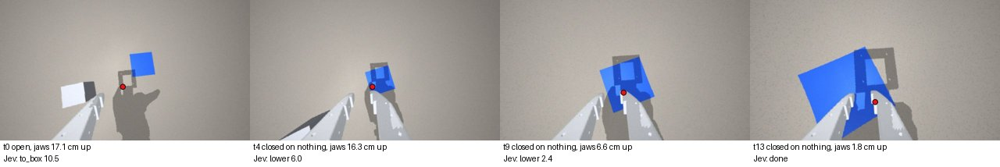
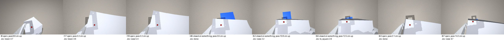
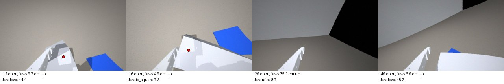

# Jev runs the arm

How far does pure reactive Jev control get on the valet-sim benchmark? On seeds 0-19, wrist camera only:
**placed 0/20 and lifted 10/20**. Jev picks every move. Claude Opus 5.5 writes the one-sentence goal it pursues
(11 sentences per episode on average). Jev alone, with the task sentence as its goal, places 0/20 and lifts 0/20.
The scripted expert, which reads the true pose, places 13/20 and lifts 15/20.

| seeds 0-19, 100 ticks | placed | lifted | touched box | median s/episode | Jev calls/ep | Claude calls/ep | $/episode |
|---|---|---|---|---|---|---|---|
| Jev only (the goal is the task sentence) | 0/20 | 0/20 | 7/20 | 157 | 81 | 0 | 0.007 |
| **Jev moves, Claude writes the goal** | **0/20** | **10/20** | 20/20 | 149 | 80 | 10.8 | **0.066** (Jev 0.007, Claude 0.058) |
| same, plus the side camera for Jev and Claude (comparison only; the real arm has no side camera) | 0/20 | 7/20 | 20/20 | 152 | 92 | 10.2 | 0.087 |

Seconds per episode are simulated arm time plus model time, which is what the real arm would take. Models are
called synchronously and the arm holds still while they answer. The median is 118 s of arm time plus 36 s of
model time. Wall clock was 45 s per episode, five episodes at a time.

Each Jev call sends about 2,100 input tokens (one 640x360 frame and nine questions). It costs $0.00009 and
takes 0.2-1 s. Each Claude call is about 660 tokens in and 140 out at effort low, roughly $0.005. Claude is 89%
of the cost. All the runs behind this report, 163 episodes, cost $8.6.

## The loop

Every tick, one Jev request (`jev_policy.py`). The state holds the goal sentence, the arm and the last move. The
arm part has the joints, the jaw height and whether the jaws are open, closed on something or closed on nothing.
The upright wrist frame goes with it, with one addition: a **red dot on the table straight below the jaws**,
drawn from the joint readings and the camera model only. The request asks nine questions:

- `move:next`, a choice: `to_box`, `to_square`, `lower`, `raise`, `turn_cw`, `turn_ccw`, `open`, `close` or
  `done`. "Which move brings the arm closer to `goal`?"
- `where:box` and `where:square`, choices of ahead, back, left, right or here: "Where is the white box (the blue
  square) relative to the red dot?"
- `far:box` and `far:square`, scores in cm (under 1, 1, 2, 4, 8, 16+): how far across the table each one is
  from the dot.
- `far:height`, a score in cm: how far up or down the goal needs the jaws to go.
- `far:turn`, a score in degrees: how far the jaws are off square with what they will grip.

Code turns the answers into a motion and nothing more. `to_box` moves the jaws by Jev's probability-weighted
direction times its distance: an unsure Jev takes a short step. `lower` and `raise` use the height score, and
the turns use the degree score. `open` and `close` drive the gripper, with `close` holding where the jaws stall.
Moves go through the sim's IK, keeping the current pitch and roll.

Claude only writes the goal sentence. It sees the wrist frame and the arm state. It writes the first goal, and
writes again when Jev answers `done` or when progress stalls. A stall is 6 ticks in which the jaws stay within
1.5 cm and the jaw state doesn't change, so opening and closing in place counts too. Claude replies `DONE` to
end the episode. The limits are 100 ticks and 12 goals.

One fix to the sim's camera, applied in the experiment rather than in `sim/`: MuJoCo's near clip plane was
3.2 cm. Once the box was between the jaws, its top was clipped and the wrist frame showed bare table. The
experiment sets it to 4 mm. Details are in the shared notes; it belongs in `sim/scene.py`.

## What moved the score (seeds 0-4)

One change at a time. Ties on placed and lifted were broken by "touched the box" and by the closest the jaws
came to the box centre. Rows 1-4 are one run of 60 ticks each. From row 5 on it is 100 ticks, and from row 8
on each config ran twice (10 episodes). Until row 11, Claude also saw the side frame. The wrist-only rule came
after, and the headline runs follow it.

| # | change | eps | placed | lifted | touched | median closest | kept |
|---|---|---|---|---|---|---|---|
| 1 | Jev picks image-direction moves (ahead, back, left, right, lower, raise, turn, open, close, done), with a cm score per axis | 5 | 0 | 0 | 1 | 8.7 cm | start |
| 2 | red dot on the table below the jaws | 5 | 0 | 0 | 4 | 5.3 cm | yes |
| 3 | `to_box`/`to_square`, with the step from "where is X relative to the dot" and "how far" | 5 | 0 | 0 | 4 | 3.3 cm | yes |
| 4 | bug: jaws stalled on the box still read "open", so Jev kept closing | 5 | 0 | 2 | 5 | 2.1 cm | fix |
| 5 | Jev only, no Claude | 5 | 0 | 0 | 1 | 13.3 cm | baseline |
| 6 | Claude goals (as row 4, at 100 ticks) | 5 | 0 | 1 | 5 | 3.1 cm | |
| 7 | memory of where the box and the square were last seen | 5 | 0 | 0 | 4 | 3.6 cm | no |
| 8 | row 6 again, twice | 10 | 0 | 0 | 8 | 4.6 cm | |
| 9 | open/close in place counts as a stall, and the goal cap goes from 6 to 12 | 10 | 0 | **4** | 10 | 2.3 cm | yes |
| 10 | Claude checks Jev's `done` against the frames before moving on | 10 | 0 | 1 | 9 | 2.8 cm | no |
| 11 | Claude sees the wrist frame only (rule change) | 10 | 0 | 2 | 10 | 2.7 cm | required |
| 12 | + memory (row 7 again, wrist only) | 10 | 0 | 3 | 10 | 2.8 cm | no: within noise, more code |
| 13 | "set it down **upright**" in the task sentence | 10 | 0 | 4 | 10 | 3.2 cm | no: boxes still land on their side |

Rows 2 and 3 came from a probe (`probe.py`): 20 frames with the open jaws 2-9 cm from the box or the square,
graded from the true pose.

- Asked "which move brings the arm closer to the goal?", Jev picked the right image direction 20-30% of the time.
  Chance is 25%. It answered `done` on half the frames.
- Asked "where is the white box relative to the red dot?", it was right 75-80% of the time, with p = 0.6-0.7 on
  the right answer. Every step taken from that answer landed closer, and the median gap halved per step.
- Its distance scores track the true offset at r = 0.8.

The same "where" question with a goal-generic object ("the place `goal` needs the jaws over") dropped to 40%.
Jev reads scenes well and plans moves poorly, so the moves have to be phrased as scene questions.

Single runs are noisy. Row 4's config lifted 2/5, and its rerun in row 8 lifted 0/10, because Claude's goal
sentences differ from run to run. Take any difference of one or two lifts in ten as noise.

## Where it fails (seeds 0-19, Jev + Claude, wrist only)

| outcome | episodes |
|---|---|
| never closed the jaws | 4 |
| closed on nothing, beside the box | 4 |
| gripped the box but never lifted it 2 cm | 2 |
| lifted, still holding it when the ticks or goals ran out | 5 |
| lifted, then dropped it or set it down off the square | 4 |
| lifted and set it down within 6 cm of the square's centre | 1 (seed 4: 0.1 cm off, but on its side) |

16 of 20 boxes ended tipped more than 15 degrees. 18 episodes ended on the tick or goal cap, and 2 on Claude's `DONE`.

**Jev alone heads for the wrong object.** With the task sentence as its goal, it goes to the blue square first,
closes on nothing and says `done` (seed 3, below). It can't order the steps of a task from one frame. Every lift
in this report came from Claude breaking the task into goals: "move until the red dot sits on the box", "lower
until the box is between the jaws", "close", "lift", "carry", "lower", "open".



**It pushes the box over, and nothing tells it so.** In seed 4, Jev answers `lower` while the jaws rest on the
box's top. From t6 to t10, each `lower` of about 4 cm moves the jaws 0.2-0.8 cm. Then the box tips, the jaws drop
to 3.2 cm and stay there for four more `lower`s, and the next `raise` lifts the box wedged between the open jaws.
The move result always says "moved". The loop never reports that a move was blocked, though the joint readings
show it.

**It grips low, so the box swings.** Claude's goals say "lower until the box is between the jaws at table level",
so Jev closes 2-4 cm above the table. The box then pivots in the jaws, and every box set down near the square
landed on its side. In seed 4 the whole sequence worked: grip, lift, carry, lower, open, `DONE`. The box landed
0.1 cm from the centre of the square, tilted 90 degrees.



**It carries blind.** With the box in the jaws, the box fills the wrist frame, and the square shows only as a
sliver at the edge (seed 4, t52-t56). Remembering where the square was last seen (row 12) didn't change the
outcome. Raising the arm high doesn't help either: above about 20 cm the current pitch is out of reach. The move falls
back to another pitch, and the camera turns toward the wall (seed 6, t29). Jev then goes up and down for 17 ticks.



**It runs out of budget.** Most episodes end at 100 ticks or 12 goals in the middle of a stage. Jev also answers
`done` early on many goals, and each early `done` costs a Claude call.

## Next step

Report blocked moves, and test the grasp height through what the real arm can sense, not through a recipe.
After each move, put "moved 0.4 of 4 cm" in the state instead of "moved", from goal versus reached joints;
gripper current would also work. Jev can then see that it is pressing on the box. Then rerun seeds 0-4 twice.
The pushed-over boxes and the low grip are the shortest path to a first placement: one episode already landed
0.1 cm from the centre, only on its side. If placement stays at 0, the grasp is the part to learn rather than
prompt. The expert's demonstrations in `valet_sim.expert` are the data for that. The point-and-reach team found
that gripping 2.5 cm below the box's top took the expert from 17/20 to 20/20.

## Running it

```bash
cd experiments/jev-policy && uv sync
uv run python jev_policy.py --seeds $(seq 0 19) --tag full        # Jev + Claude, wrist only
uv run python jev_policy.py --seeds $(seq 0 19) --no-claude        # Jev alone
uv run python jev_policy.py --seeds 0 1 2 3 4 --repeats 2 --side   # comparison: side camera too
uv run python summarize.py runs/<run>                              # per-seed table
uv run python probe.py                                             # Jev's direction and distance on 20 graded frames
```

It reads `TYPESAFE_API_KEY` and `ANTHROPIC_API_KEY` from the nearest `.env` above it. Each episode runs in its own
process. `runs/<run>/seed*/` holds every tick's frame, Jev's answers, the move, and grading fields taken from
`truth()`, which the policy never sees. Use `--resume runs/<run>` to finish an interrupted run.
