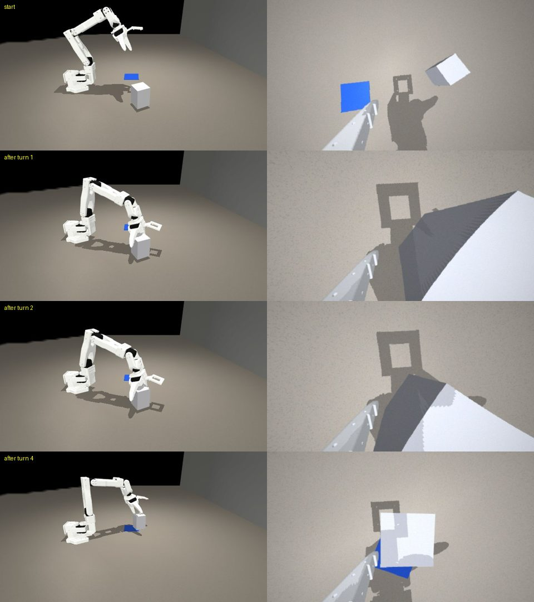
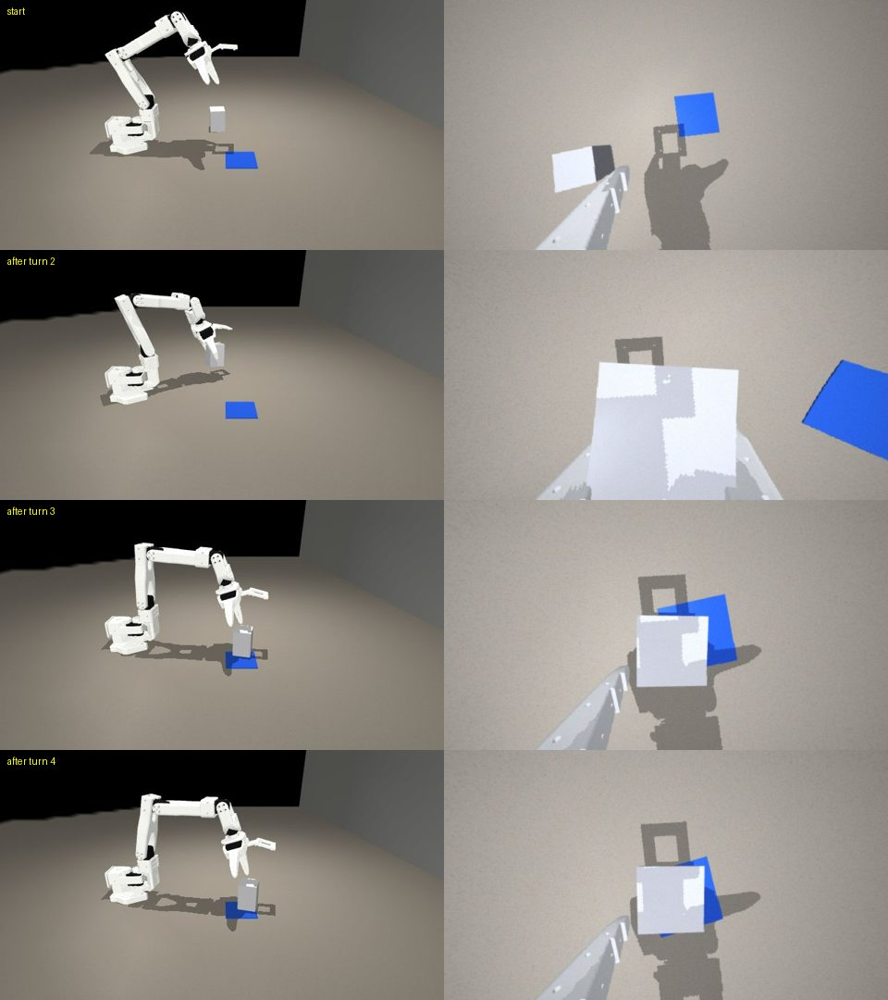

# Physical Agent on valet-sim: end-effector sequence tool calls, frontier models, no training

**Question.** Can Claude, acting only through `execute_absolute_eef_sequence` calls (the
[Physical Agent](https://physical-agent-project.github.io/) interface), solve the valet-sim pick-and-place
benchmark? How much does one in-context demonstration help?

**Answer: no, and the demonstration helps grasping, not placing.** With the wrist camera only (the real arm has
no other camera), Claude Opus 5.5 placed **1/20 zero-shot and 2/20 with one expert demonstration** in context. The
best wrist-only condition, the demo with gripper-relative targets, placed 5/20. The scripted expert, which reads the
true box pose, places 12/20 through the same tool. The demonstration makes the grasp work. Opus held 44% of its
grasps with the demo against 9% without, and lifted the box in 16/20 episodes against 8/20. Episodes shrank from 15
turns to 5, and cost from $0.26 to $0.14. Opus uses the demo as a ruler: it compares where the box sits in the
demo's wrist frame with the coordinates the expert went to. Placing does not improve. Opus releases the box 2-5 cm
from the square's centre, mostly to the same side, in a single lower-and-open call, then calls a box overhanging the
square "done". The paper's control, a demo of a different task from the same start, helps grasping as much (15/20
lifted), because it carries the same calibration. Adding the paper's fixed scene camera is what moves placement:
Opus zero-shot with both views placed 7/20, against 1/20 with the wrist alone. The real arm has no such camera.
Cheaper models break earlier. Sonnet 5.5 placed 4/20 zero-shot but 0/20 with the demo. Haiku 5.5 placed 0/20
zero-shot and 2/20 with the demo, at well under a cent per episode. Both run the demo as a one-call script and stop
with the box elsewhere.

**Recommendation.** Don't build the controller on this interface. The weak link is turning what the model sees in a
camera that moves with the arm into absolute metres, done in the model's head. Claude points at the box to within a
few pixels (point-and-reach and aspire notes), so that conversion belongs in code, as in point-and-reach. Fine-tuning
a small open model on sim demos is a reasonable experiment *later*: the expert can generate unlimited demos in this
exact interface. It is not the next step; see the end.

## Setup

- **Benchmark**: valet-sim seeds 0-19. `task.score`'s placed means the box centre is within 3 cm of the square's,
  upright, resting and released. The sim's expert places 13/20 with direct joint control. The same plan run through
  this tool places 12/20 and lifts 17/20, so the tool itself costs the task almost nothing.
- **Tool** (`physical_agent/tool.py`): up to 8 targets `{x, y, z, roll_deg, pitch_deg, gripper, control_steps}`,
  solved with `valet_sim.ik` and run in order. The result is `executed N targets`, or which target was unreachable.
  **Yaw is dropped.** The SO-101 has 5 joints and the shoulder pan points the arm at the target's xy, so the jaws'
  heading is not free; a yawed box is matched with roll at a steep pitch. `control_steps` is 0.1 s ticks for the move,
  plus up to 3 s to settle.
- **Each turn**: the wrist frame (640x360) and the joint and end-effector state as text, then brief reasoning and one
  call. History, including thinking, stays in context. The episode ends when the model replies without a call, or at
  15 turns. The prompts are short and give no grasp advice (`agent.system`, the tool description).
- **Conditions**:
  - *zero*: the instruction only.
  - *demo*: the expert on seed 104, as three wrist observations, each followed by the call it made, in the agent's
    own frame.
  - *distractor*, the paper's control: the expert from the same start doing a different task (lift the box and set
    it back where it was).
  - Variant *gripper frame*: targets are forward/left/up offsets from where the jaws are.
  - Variant *both views*: wrist plus the scene camera, the paper's setup. Comparison only.
- **Models**: Claude Opus 5.5 (effort medium, adaptive thinking), Claude Sonnet 5.5 and Claude Haiku 5.5 at their
  defaults. One episode per seed; nothing retried or cherry-picked.
- **Sim fix**: the wrist camera's near clip plane moved from 3.2 cm to 4 mm (jev-policy's note); otherwise the box
  between the jaws vanishes from the frame.

## Results, seeds 0-19

| model | views | frame | condition | placed | lifted | held / grasps | median turns | median s (wall / sim) | median tokens | $ / episode | $ / 20 |
|---|---|---|---|---|---|---|---|---|---|---|---|
| expert (true pose) | - | joints | - | 13/20 | 15/20 | | | | | 0 | 0 |
| expert plan via this tool | - | base | - | 12/20 | 17/20 | | | | | 0 | 0 |
| **Opus 5.5** | wrist | base | zero | **1/20** | 8/20 | 9/100 | 15 | 90 / 78 | 130k | 0.26 | 5.20 |
| **Opus 5.5** | wrist | base | demo | **2/20** | 16/20 | 21/48 | 5 | 37 / 23 | 34k | 0.14 | 2.90 |
| Opus 5.5 | wrist | base | distractor | 4/20 | 15/20 | 18/50 | 5.5 | 36 / 25 | 37k | 0.18 | 3.64 |
| Opus 5.5 | wrist | gripper | zero | 0/20 | 4/20 | 23/115 | 15 | 94 / 91 | 130k | 0.26 | 5.13 |
| Opus 5.5 | wrist | gripper | demo | 5/20 | 14/20 | 25/67 | 5 | 50 / 28 | 35k | 0.18 | 3.65 |
| Sonnet 5.5 | wrist | base | zero | 4/20 | 10/20 | 14/54 | 9.5 | 46 / 36 | 43k | 0.06 | 1.16 |
| Sonnet 5.5 | wrist | base | demo | 0/20 | 3/20 | 8/43 | 4 | 23 / 26 | 23k | 0.05 | 1.09 |
| Haiku 5.5 | wrist | base | zero | 0/20 | 3/20 | 10/59 | 15 | 54 / 50 | 118k | 0.006 | 0.11 |
| Haiku 5.5 | wrist | base | demo | 2/20 | 9/20 | 13/66 | 5.5 | 43 / 36 | 46k | 0.004 | 0.09 |
| Opus 5.5 | both | base | zero | 7/20 | 14/20 | 17/89 | 10.5 | 84 / 61 | 93k | 0.23 | 4.65 |
| Opus 5.5 | both | base | demo | 4/20 | 12/20 | 18/51 | 4.5 | 46 / 24 | 38k | 0.21 | 4.26 |

Behaviour per condition (from the logged true pose, which the model never saw):

| run | first-grasp miss (cm) | stopped unplaced | hit 15 turns | lifted, not placed: >3 cm off / tilted / in jaws | grasps at the demo's pose | grasps with roll turned |
|---|---|---|---|---|---|---|
| opus-wrist-base-zero | 3.9 | 2/20 | 17/20 | 6 / 7 / 0 | 0/100 | 10/100 |
| opus-wrist-base-demo | 1.7 | 14/20 | 4/20 | 13 / 2 / 4 | 27/48 | 13/48 |
| opus-wrist-base-distractor | 1.6 | 10/20 | 6/20 | 10 / 0 / 3 | 23/50 | 14/50 |
| opus-wrist-gripper-zero | 3.5 | 3/20 | 17/20 | 2 / 3 / 0 | 0/115 | 17/115 |
| opus-wrist-gripper-demo | 1.9 | 10/20 | 5/20 | 6 / 4 / 1 | 28/67 | 29/67 |
| sonnet-wrist-base-zero | 2.6 | 7/20 | 9/20 | 6 / 3 / 0 | 0/54 | 5/54 |
| sonnet-wrist-base-demo | 2.8 | 13/20 | 7/20 | 3 / 0 / 1 | 24/43 | 5/43 |
| haiku-wrist-base-zero | 4.1 | 12/20 | 8/20 | 3 / 1 / 1 | 0/59 | 0/59 |
| haiku-wrist-base-demo | 2.6 | 18/20 | 0/20 | 6 / 3 / 0 | 50/66 | 0/66 |
| opus-both-base-zero | 2.7 | 5/20 | 8/20 | 7 / 2 / 1 | 0/89 | 10/89 |
| opus-both-base-demo | 2.0 | 8/20 | 8/20 | 8 / 2 / 1 | 22/51 | 7/51 |

*Grasps* counts every closing of open jaws; *held* means the box then left the table. *Miss* is the xy distance from
the first closing point to the box centre. *Stopped unplaced* counts episodes where the model replied without a call
(done, or giving up) and the box was not placed. *Roll turned* counts grasps with roll moved at least 5 degrees from
-90. Per-seed rows: `results/*.json`. Seconds are wall time including API calls, then simulated time. Dollars use
list prices with prompt caching.

Spend: $35.50 recorded across every run in this report (including the seeds 0-4 runs and a pilot). A few dollars
more went on episodes cut short by a machine-wide process kill and by render timeouts; those episodes were re-run
and are not counted. No condition came near the $20 cap: the most expensive, Opus zero-shot, cost $5.20 for 20
seeds.

**What is significant at n=20.** The demo's effect on grasping is: held grasps 9/100 vs 21/48 (Fisher p < 0.0001),
lifted 8/20 vs 16/20 (p = 0.02). So is the scene camera's effect on placing: 1/20 vs 7/20 zero-shot (p = 0.04).
Placed differences among the wrist-only conditions are not (0-5/20, every pairwise p > 0.1). Every wrist-only
condition is far below the expert (Opus with the demo 2/20 vs 12/20, p = 0.002).

Earlier runs with the first demo seed (101), whose grasp was at roll 80; seeds 0-4 only, both views:

| model | condition | placed | lifted | median turns | $ / episode |
|---|---|---|---|---|---|
| Opus 5.5 | demo (seed 101) | 1/5 | 2/5 | 15 | 0.30 |
| Opus 5.5 | distractor (seed 101) | 1/5 | 4/5 | 12 | 0.28 |
| Haiku 5.5 | demo (seed 101) | 1/5 | 2/5 | 12 | 0.01 |

## What the demonstration does

- **It is a ruler.** Opus writes, for example: "In the demo, a box seen at about (405,180) in the wrist camera was at
  x≈0.272, y≈-0.082. Here the white box is at about (433,168), a little further right and higher in the image, so I
  estimate ...". Its first grasp then lands a median 1.7 cm from the box centre, against 3.9 cm zero-shot, and holds
  far more often. Lifted doubles and episodes shrink from 15 turns to 5. Zero-shot, Opus finds the box by trial and
  error and runs out of turns in 17/20 episodes.
- **It is copied.** 27 of Opus's 48 grasps with the demo close at exactly the demo's pose (pitch 70, roll -90,
  z 3.5 cm); 50 of Haiku's 66 do. The first demo seed we tried (101) grasped at roll 80, which turns the wrist camera
  nearly upside down. Opus copied roll 80 as well, then could not read its own wrist view ("with the roll at 35
  degrees I can't tell which way left is") and knocked the box over (frames below). We switched to the first seed
  whose expert grasp keeps the camera level (`demo.demo_seed`, seed 104).
- **The distractor works almost as well**, unlike in the paper (where it took 44.8% down to 36.2%). It starts from
  the same frame as the task demo, so it gives the same calibration. Opus ignores its ending ("set it back where it
  was") and carries the box to the square. With one object and one target there is little for a wrong task to
  mislead.
- **It does not teach placing; it may hurt it.** With the demo, Opus's first release is a median 4.0 cm from the
  square's centre. In 13/16 episodes it is too far to the gripper's left, by a median 3.7 cm. The same leftward
  bias shows in every demo condition: gripper frame 13/14, Haiku 8/9, Opus with both views 11/12. Zero-shot and
  distractor releases show none (3/8, 8/15, 6/14 to the left). Part of it is the demo itself: the expert gripped
  1.4 cm off the box centre and released 1.2 cm left of the square to make up for it, and the agent copies the
  release without the off-centre grip. Then Opus lowers and opens in one call without looking first. In the next
  frame it sees blue along one edge and still calls it done: "a strip of blue still shows on its left, so it sits
  about 1-2 cm to the right of the square's centre" (it was 3.0 cm off). 13 of the 14 lifted-but-not-placed demo
  episodes ended more than 3 cm off; 14/20 stopped with the box unplaced.

## Failure examples

The left frames (scene camera) are for the reader. The model saw only the right frames (wrist camera).

**Zero-shot: depth from one wrist view, and "held" that isn't** (`opus-wrist-base-zero`, seed 3).

Opus overestimates the box's distance by 2-5 cm on every approach, closes in front of it, and tips it over (turn 3).
After turn 8 the closed, empty jaws hover over the box, and in the wrist image it looks held: "The box looks like
it's sitting between the jaws now ... it's probably being held even though the gripper reads 0.0 again." It carries
nothing to the square (turn 9). The gripper reading was the right signal and it argued past it. Across the
wrist-only runs, jaws shut on nothing read 10 or less in 438 of 445 cases; holding the box they read a median 23
(below 10 in 28 of 109, mostly corner grips). 15 turns, never lifted.

**Demo: a near miss called done** (`opus-wrist-base-demo`, seed 1).

The first approach lands beside the box. Opus sees it, shifts 2 cm and grasps on the second try (turn 2): good
recovery. It carries the box to its estimate of the square, lowers and opens in one call, and stops: "the camera
shows the box mostly covering the square, though a little blue still shows along one side". The box is 3.8 cm off.

**Demo: a success after a correction** (`opus-wrist-base-demo`, seed 3).

It grasps on the first try (turn 2). After the first release it sees the box "partly over the blue square, maybe
40% of it covered". It re-grasps, nudges the box 2 cm and releases again (turn 4): 2.3 cm off, placed.

**Copying a demo's odd roll** (`opus-both-base-demo101`, seed 0; both views, the seed-101 demo).

The demo grasped at roll 80. Opus copies it, so its wrist view is nearly upside down. It misjudges which way the box
is, clips it and knocks it onto its side (turn 3), and never recovers.

**Haiku with the demo: an open-loop script** (`haiku-wrist-base-demo`, seed 0).

Turn 1 is the demo's whole plan in one call: descend, close, lift, carry, lower, open. It closes 5 cm short of the
box and carries nothing. It notices ("The earlier grasp probably missed the box"), runs the same script 2 cm over,
and ends without a call: "I can't confirm the task is complete."

## Recovery after failed grasps

Models notice failed grasps; they rarely fix them. The turn after a failed grasp says it failed (a keyword check on
the reasoning) in 57-79% of cases for Opus, 87-90% for Haiku (which reads the gripper value) and 35-44% for Sonnet.
Zero-shot runs keep the jaws shut on the next call 10-15 times per 20 episodes, often carrying nothing; with the demo
this happens about once. Zero-shot, Opus had a failed grasp in all 20 episodes and retried in 19, but a later grasp
held in only 2. It re-aims by 1-3 cm a time, usually keeping pitch and roll, so a box yawed 30-45 degrees to the jaws
keeps being gripped on its corners and pushed or tipped (7 of the 7 lifted-but-unplaced zero-shot boxes ended
tilted). With the demo, fewer grasps fail; 3 of the 8 episodes with a failed grasp recovered. The recoveries that
work look the same everywhere: lift, shift 1-2 cm by what the wrist view shows, descend, close, and check the
gripper reading before carrying. Haiku never turns roll. Opus does in 10-43% of its grasps, most often in the
gripper frame with the demo.

## Cheaper models: where they break

- **Sonnet 5.5** zero-shot is the cheapest decent result: 4/20 placed, 10/20 lifted, $0.06 per episode, in a median
  9.5 turns. It servos visually in small steps ("The box now fills the right-centre of the view, so it's close. I'll
  move forward and down a little"). With the demo it collapses (0/20 placed, 3/20 lifted; lifted p = 0.04 against
  zero-shot). It tries to map the demo's layout onto the new scene ("Here the layout is mirrored"), commits to wrong
  coordinates, and stops early: median 4 turns, 13/20 stopped unplaced.
- **Haiku 5.5** costs $0.004-0.006 per episode. Zero-shot it probes with one-target moves and reads the gripper value
  right ("closed fully to 0.1, which means it closed on nothing"), but its first grasp misses by a median 4.1 cm.
  It pushes the box around and lifts 3/20. With the demo it lifts 9/20 and places 2/20, but runs the demo as a script
  (grasp-to-release in one call) and stops in every episode, 18 of them unplaced.
- In short: cheaper models stop checking between steps. Opus uses the turn after each call to look; Haiku and
  Sonnet with a demo pack the whole task into one call.

## Absolute vs gripper-relative targets

Relative targets (forward/left/up from the jaws) read naturally off the wrist image ("shift slightly right and
back"), but zero-shot they did not help. Opus placed 0/20 and lifted 4/20, and held 23/115 grasps against 9/100 with
absolute targets. It still has to guess metres from pixels, and its steps are too small to finish in 15 turns
(17/20 hit the budget). With the demo, the gripper frame gave the best wrist-only result, 5/20 placed and 14/20
lifted. That is not significantly better than absolute targets with the demo (2/20, p = 0.4). The frame is not the
bottleneck. Seeing the scale is.

## Two views vs wrist only

The paper's setup adds a fixed scene camera. With it, zero-shot Opus placed **7/20** (lifted 14/20), against
1/20 with the wrist camera alone (placed p = 0.04). It is the best result in this report, though still short of the
expert's 12/20 (p = 0.2). The fixed view gives a reference that does not move with the arm. Opus reads positions
off it, sees after release that the box "landed past the square", and re-grasps and nudges. All 7 placed episodes
took more than one grasp (a miss, or a re-grasp to nudge). The demo did not add to two views (4/20 placed, 12/20
lifted; p = 0.5). It cut turns from 10.5 to 4.5 again, and the leftward release bias came with it (11/12). The real
arm has no scene camera. This is the strongest sign here that the interface's success in the paper rests on a fixed
view as much as on the model. If a fixed camera can be mounted over the real desk, it is worth testing for whatever
controller comes next.

## Recommendation

1. **Don't use this interface as the controller.** Its premise is that a general model can turn camera views into
   absolute end-effector targets. On this task Opus 5.5 grasps once it has a calibration example, but it cannot place
   to 3 cm from a wrist camera. It stops with the box overhanging the square. The paper's agent was a fine-tuned 4B
   with a fixed scene camera beside the wrist one. Give Opus that camera and it places 7/20 zero-shot; with the wrist
   alone, the real arm's setup, no model or condition here passed 5/20.
2. **Keep what worked and move it into code.** The demo's value was a pixel-to-metre ruler; code can compute that
   ruler exactly from the joint state and the camera model (point-and-reach, aspire, claude-policy's grid overlay).
   Two behaviours are worth keeping from these logs: after each move, look and re-aim by what the wrist view shows;
   and trust the gripper reading over the image to say whether the box is held. A pipeline where the model points
   (box, square, "is it centred?") and code does the metres and the fine alignment keeps the model's strong part and
   drops its weak part.
3. **Fine-tuning a small open model on sim demos: worth a later, bounded experiment, not now.** For it: the expert
   produces unlimited demonstrations in exactly this tool format, with frames and calls; the paper's 4B was
   fine-tuned this way; and the failure here (placing 2-5 cm off, a systematic bias) is the kind of calibration a
   fine-tune learns well. Against it: the expert places 12/20, so imitating it caps out low; the wrist camera's look
   is fitted to only two real frames, so the sim-to-real gap is untested; and a trained visuomotor policy has already
   been judged the wrong approach for this project. If it is run, keep it narrow. Fine-tune only the step that failed (given the
   wrist frame and the arm pose, output the square's position or the release offset), compare against the code
   pipeline above, and stop if it does not beat it in sim.

## Caveats

- One episode per seed and condition. Twenty episodes separate large differences only; one placed episode is 5
  points.
- One demonstration seed (104), chosen by rule: the first seed outside 0-19 where the expert succeeds with a level
  wrist camera. Other demo seeds will move the numbers; the seed-101 runs show how much.
- Opus ran at its default effort (medium). Higher effort, more turns, and any hint about centring the box were not
  tried, by design (short prompts, no recipes). Placement is where they might help.
- The 3 cm tolerance is the benchmark's. Most of Opus's lifted-but-unplaced boxes with the demo overlapped the square,
  with the centre 3-5 cm off.
- Sim only. The near-clip fix is ours, and the wrist camera's look, the gripper reading and the lighting are fitted
  approximations of the real arm.
- Runs were interrupted twice: a machine-wide process kill, and render timeouts with about 80 sims on the GPU. Every
  interrupted episode was re-run from scratch, and only complete episodes are counted.
