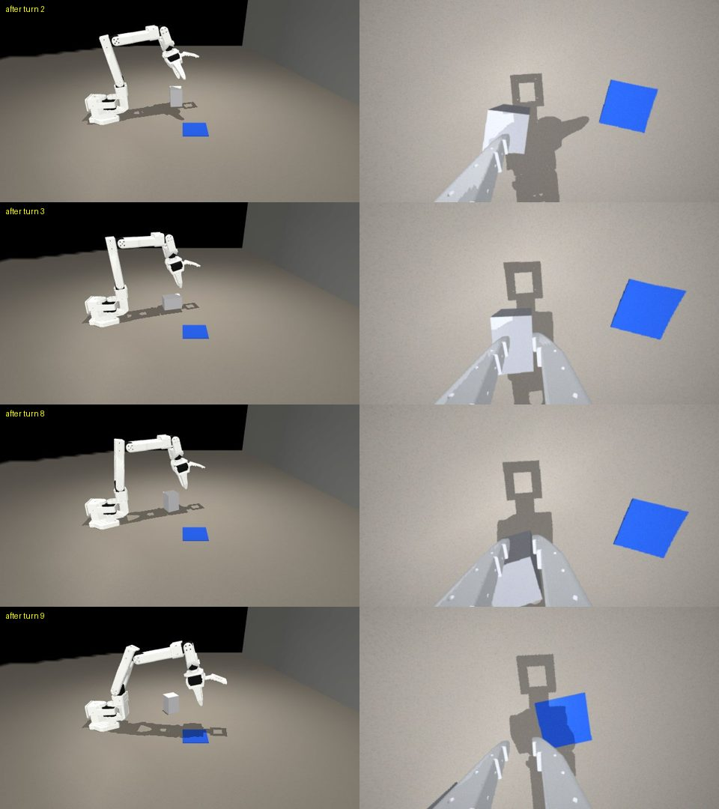
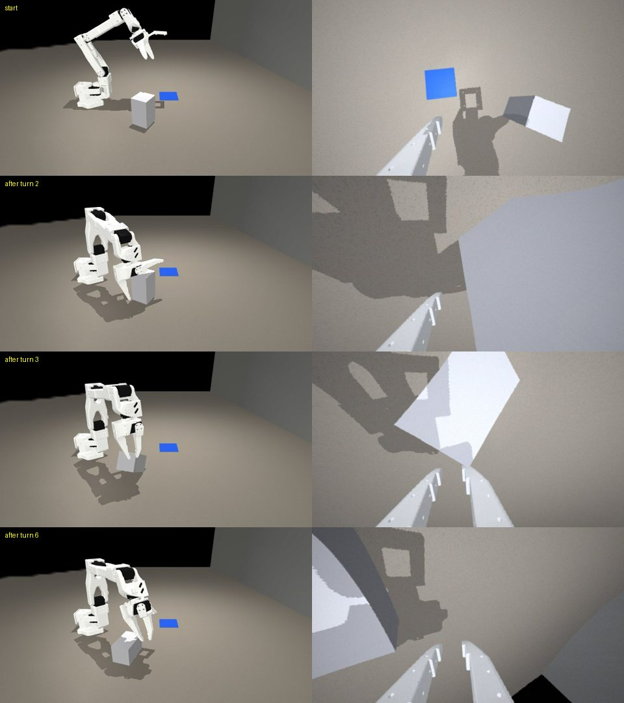
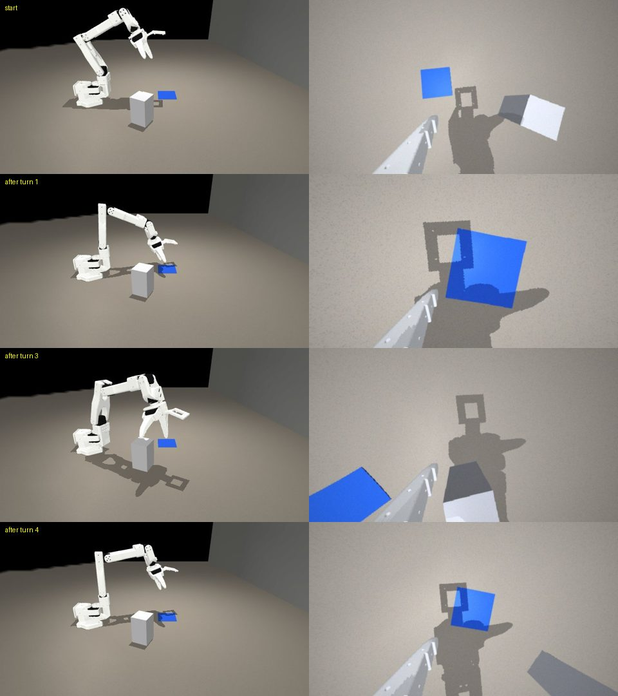

# Physical Agent on valet-sim: end-effector sequence tool calls, frontier models, no training

**Question.** Can Claude, acting only through `execute_absolute_eef_sequence` calls (the
[Physical Agent](https://physical-agent-project.github.io/) interface), solve the valet-sim pick-and-place
benchmark? How much does one in-context demonstration help?

**Answer.** Not well enough to build on. With the wrist camera only (the real arm's only camera), Claude Opus 5.5
placed {{OPUS_ZERO}} zero-shot and {{OPUS_DEMO}} with one expert demonstration in context. The scripted expert,
which reads the true box pose, places 12/20 through the same tool. The demonstration helps a lot with *grasping*:
lifted goes from {{OPUS_ZERO_LIFT}} to {{OPUS_DEMO_LIFT}}, turns drop from 15 to about 5, and cost per episode falls
by more than half. Opus uses the demo as a ruler: it compares where things sit in the demo's wrist frame with the
coordinates the expert went to. It does not fix *placing*. Opus lets go 2-5 cm from the square's centre, nearly always
to the same side, then calls the box "on the square" and stops. The paper's control, a demo of a different task,
helps almost as much as the task demo ({{OPUS_DIST}}). That fits the ruler reading: the benefit is calibration, not
task content. Cheaper models break earlier. Sonnet 5.5 placed {{SONNET_DEMO}} and Haiku 5.5 {{HAIKU_DEMO}} with the
demo. They copy the demo as an open-loop script (grasp, carry and release in one call), never check the grasp, and
end the episode with the box elsewhere.

**Recommendation.** Do not pursue this interface as the controller. The weak link is turning what the model sees into
absolute metres from a camera that moves with the arm, done in the model's head. Claude points at the box to within a
few pixels (the point-and-reach and aspire notes), so that conversion belongs in code (point-and-reach) or on the image
(claude-policy's grid overlay). Fine-tuning a small open model on sim demos is a fair *later* experiment, since the
expert can generate unlimited demos in this exact interface. It should not come next. Details at the end.

## Setup

- **Benchmark**: valet-sim seeds 0-19 (`task.score`; placed = box centre within 3 cm of the square, upright, resting,
  released). The sim's expert places 13/20 with direct joint control. The same expert plan run through this tool
  places 12/20 and lifts 17/20, so the tool does not cost the task.
- **Tool** (`physical_agent/tool.py`): up to 8 targets `{x, y, z, roll_deg, pitch_deg, gripper, control_steps}`,
  solved with `valet_sim.ik` and run in order. The result is `executed N targets`, or which target was unreachable.
  **Yaw is dropped**: the SO-101 has 5 joints, the shoulder pan points the arm at the target's xy, so the jaws' heading
  is not free; a yawed box is matched with roll at a steep pitch. `control_steps` is 0.1 s ticks per move, plus up to
  3 s to settle.
- **Each turn**: the wrist frame (640x360) and the joint and end-effector state as text; brief reasoning, one call.
  History, including thinking, stays in context. The episode ends when the model replies without a call, or at 15
  turns. Short prompts, no grasp advice (`agent.system`).
- **Conditions**: *zero* (instruction only); *demo* (the expert on seed 104: three wrist observations, each followed
  by the call it made, in the agent's own frame); *distractor* (the paper's control: the expert from the same start
  doing a different task, lifting the box and setting it back where it was). Variants: *gripper frame* (targets as
  forward/left/up offsets from where the jaws are), and *both views* (wrist plus the scene camera, the paper's setup;
  comparison only, since the real arm has no scene camera).
- **Models**: Claude Opus 5.5 (effort medium, adaptive thinking), Claude Sonnet 5.5 and Claude Haiku 5.5 at their
  defaults. One run per seed; no retries.
- **Sim fix**: the wrist camera's near clip plane moved from 3.2 cm to 4 mm (jev-policy's note), or the box between
  the jaws vanishes from the frame.

## Results, seeds 0-19

{{TABLE}}

Columns: *grasps (held)* counts every time the jaws closed from open, and how many of those got the box off the
table. *Ended without a call, not placed* is the model stopping (claiming done, or giving up) with the box not placed.
*Median miss at first grasp* is the xy distance from where the jaws first closed to the box centre. *Grasps at the
demo's pose* counts closings at exactly the demo's pitch 70, roll -90, z 3.5 cm. *Roll turned* counts grasps where
the model moved roll away from -90. Per-seed rows are in `results/`.

Earlier runs (seeds 0-4 only, both views):

{{TABLE_EARLY}}

## What the demonstration does

- **It is a ruler.** Opus writes things like "In the demo, a box seen at about (405,180) in the wrist camera was at
  x≈0.272, y≈-0.082. Here the white box is at about (433,168) ... so I estimate ...". The first grasp lands
  {{MISS_DEMO}} cm from the box centre with the demo, against {{MISS_ZERO}} cm zero-shot. That is the whole gain:
  lifted rises, and turns and cost fall, because the first grasp usually works.
- **It is copied.** {{COPY}} of Opus's grasps with the demo close at exactly the demo's pose (pitch 70, roll -90,
  z 3.5 cm), as do nearly all of Haiku's. The first demo we tried (seed 101) grasped at roll 80, which turns the wrist
  camera nearly upside down. Opus copied roll 80 too, then could not read its own wrist view ("with the roll at 35
  degrees I can't tell which way left is") and knocked the box over (frames below). We switched to the first demo
  seed with a level camera (`demo.demo_seed`). Both demo seeds' runs on seeds 0-4 are in the early table.
- **The distractor helps almost as much.** It starts from the same frame as the task demo, so it carries the same
  calibration. Opus ignores its different ending ("set it back") and carries the box to the square. In the paper the
  distractor hurt (44.8% to 36.2%); here, with one object and one scene, there is little to mislead.
- **It does not teach placing.** With the demo, Opus lets go 2-5 cm from the square's centre, almost always too far
  to the gripper's left. The box then lands another ~1 cm forward of the release point, where the low grip
  (copied from the demo's 3.5 cm) leaves it. It lowers and opens in one call, without looking first. In the next frame
  it sees blue along one edge and still calls it done: "a strip of blue still shows on its left, so it sits about 1-2
  cm to the right of the square's centre" (the box was 3.0 cm off). {{NOT_PLACED_OFF}}

## Failure examples

Scene frames (left) are for the reader; the model saw only the wrist frames (right).

**Zero-shot: depth from one wrist view, and "held" that isn't** (`opus-wrist-base-zero` seed 3).

Opus overestimates the box's distance by 2-5 cm on every approach, closes in front of it, and tips it (turn 3).
After turn 8 the closed jaws hover over the box, and in the wrist image it looks held: "The box looks like it's
sitting between the jaws now ... it's probably being held even though the gripper reads 0.0 again." It carries
nothing to the square (turn 9). The gripper reading (0 = closed on nothing; a held box stops it at 19-25) was the
right signal, and it talked itself out of it. 15 turns, never lifted.

**Demo: a near miss called done** (`opus-wrist-base-demo` seed 1).

The first approach lands beside the box. It sees that, shifts 2 cm and grasps on the second try (turn 2): good
recovery. It carries the box to its estimate of the square, lowers and opens in one call, and stops: "the camera
shows the box mostly covering the square, though a little blue still shows along one side". The box is 3.8 cm off.

**Demo: a success with a correction** (`opus-wrist-base-demo` seed 3).

Grasp on the first try (turn 2). After the first release it sees the box "partly over the blue square, maybe 40% of
it covered", re-grasps it, nudges it 2 cm and releases again (turn 4): 2.3 cm off, placed.

**Copying a demo's odd roll** (`opus-both-base-demo101` seed 0; both views, the seed-101 demo).

The demo grasped at roll 80. Opus copies it, so its wrist view is nearly upside down. It misjudges which way the box
is, clips it, and knocks it onto its side (turn 3). It never recovers.

**Haiku with the demo: an open-loop script** (`haiku-wrist-base-demo` seed 0).

Turn 1 is the demo's whole plan in one call: descend, close, lift, carry, lower, open. It closes 5 cm short of the
box and carries nothing. It notices ("The earlier grasp probably missed the box"), runs the same script again 2 cm
off, and ends without a call: "I can't confirm the task is complete."

## Recovery after failed grasps

{{RECOVERY}}

## Cheaper models

{{CHEAP}}

## Frames: absolute vs gripper-relative targets

{{FRAME}}

## Two views vs wrist only

{{VIEWS}}

## Cost and time

{{COST}}

## Recommendation

{{REC}}

## Caveats

- One run per seed and condition. Twenty episodes resolve only large differences; one placed episode is 5 points.
- One demonstration seed (104), chosen by rule (first seed outside 0-19 where the expert succeeds with a level wrist
  camera). Demos from other seeds will move the numbers. The seed-101 run shows how much.
- Effort was Opus 5.5's default (medium). Higher effort, more turns, or a sentence asking for the box's centre over
  the square's were not tried, by design (short prompts, no recipes). Placement is where they might help.
- The 3 cm placement tolerance is the benchmark's. Most "lifted, not placed" Opus episodes with the demo left the box
  overlapping the square.
- Sim only. The wrist camera's look is fitted to two real frames; the real gripper reading, lighting and clutter
  differ.
